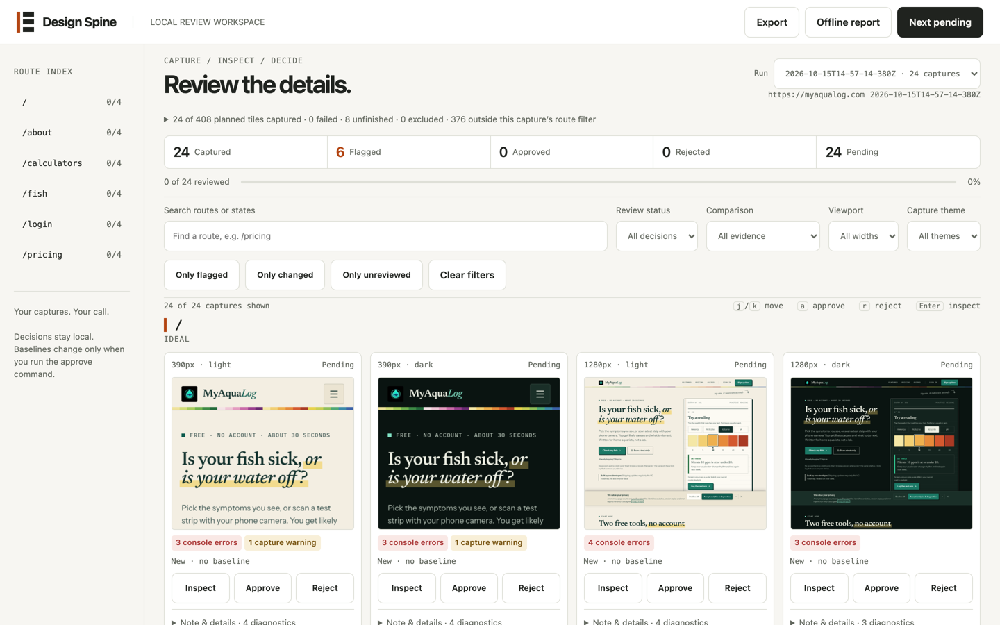

# Design Spine

Look at every screen before you ship it.

Design Spine screenshots every route of your Next.js app in every state, width and theme, flags what broke, and gives you one contact sheet to approve or reject each screen. Approved screens become baselines, and `spine diff` fails CI when a screen drifts from what a person approved.

Everything runs on your machine. No account, no upload, no per-snapshot bill.



## Why

Most UI gets built and checked in one state: the happy path, at desktop width, in light mode. AI coding agents make this worse, because they build screen by screen and never open the 390px dark-mode empty state. Design Spine makes the full matrix visible and makes "someone looked at it" a recorded fact instead of a hope.

## Quick start

Requires a running copy of your app. The CLI runs on [Bun](https://bun.sh), which the npm install bundles, so you do not install it yourself. A Bun 1.3+ already on your PATH is used first.

```bash
npm install -D design-spine
npx playwright install chromium

npx spine plan        # reads app/ and drafts design-spine.json
npx spine capture     # screenshots route x state x 390/1280 x light/dark
npx spine review      # opens the contact sheet at http://localhost:4747
```

In the contact sheet, press `j`/`k` to move, `a` to approve, `r` to reject and `Enter` to inspect a screenshot at full size against its baseline.

## What it checks on every screenshot

- HTTP errors, redirects and failed captures
- Console errors and uncaught page errors
- Horizontal overflow (the classic mobile bug)
- Near-blank regions, such as cards that rendered empty
- Broken images and clipped text
- Fixed overlays covering content, such as cookie banners and chat widgets
- Optional: axe accessibility scan, repeat-capture stability, and a Claude vision critique

Automatic checks never count as approval. Only a person approves.

## Reach the states nobody opens

Empty, loading and error states need data. Describe them in `design-spine.json` with mocked responses and interaction steps instead of seeding a database:

```json
{
  "path": "/dashboard",
  "states": [
    { "name": "ideal", "storageState": "auth/populated.json" },
    {
      "name": "error",
      "responses": [{ "url": "**/api/dashboard", "status": 503, "body": "Unavailable" }],
      "ready": { "selector": "[role=alert]" }
    }
  ]
}
```

`spine doctor` lists every state you have not made capturable yet, so missing coverage stays visible instead of silently passing.

## Gate CI on approved screens

```bash
spine approve           # approved tiles become baselines
spine diff              # exit 1 when a screen differs from its approved baseline
spine diff --strict     # also require full coverage and a person's approval on this run
spine report --out review.html   # portable offline record of what was approved and why
```

In CI, add the action after the step that starts your app, and commit `design-spine.json` and `.design-spine/baselines/`:

```yaml
- run: npm run build && (npm start &) && npx wait-on http://localhost:3000
- uses: forbiddenlink/design-spine@v0.2.0
  with:
    base-url: http://localhost:3000
```

The job fails when any screen changes from its approved baseline. The action writes a pass/fail summary with a table of changed tiles to the job summary, and uploads two artifacts: `design-spine-run` (the captures) and `design-spine-report` (a single offline HTML file with the screenshots). Reviewers open the report instead of unzipping the run.

To also post that summary on the pull request, set `comment: "true"` and grant the job write access to pull requests. The action keeps one comment, marked `<!-- design-spine -->`, and edits it on each push:

```yaml
permissions:
  contents: read
  pull-requests: write
steps:
  - uses: forbiddenlink/design-spine@v0.2.0
    with:
      comment: "true"
```

Comments are skipped outside `pull_request` events. On pull requests from forks the token is read-only, so the comment step fails without failing the job. The job summary still appears.

To accept a change, download the artifact into `.design-spine/runs/`, run `spine review --run <id>`, approve, then `spine approve --run <id>` and commit the new baselines. Fonts render differently on macOS and Linux. Capture with `spine capture --docker` and approve those baselines; the action also captures in that image by default, so the two match pixel for pixel. The first run builds a local image, and amd64 emulation on Apple silicon is slower. See [Matching CI baselines](docs/USAGE.md#matching-ci-baselines).

Upgrading from v0.1.0: that version captured with the runner's own Chromium and fonts. Baselines approved from those runs differ from docker captures, so either approve new baselines from a `--docker` capture, or keep the old behavior with `docker: "false"`.

## Commands

| Command | What it does |
|---|---|
| `plan` | Drafts `design-spine.json` from `app/` or `src/app/` |
| `doctor` | Validates the manifest and lists unfinished coverage, without a browser |
| `capture` | Screenshots every route x state x viewport x theme and runs the checks |
| `review` | Local contact sheet for approve, reject and notes |
| `critique` | Optional Claude vision pass through the `claude` CLI |
| `approve` | Promotes approved tiles to baselines |
| `diff` | Compares a run with baselines; `--strict` requires complete approved evidence |
| `report` | Self-contained HTML record of a review |
| `lint` | Ratchet on arbitrary Tailwind values such as `w-[37px]` |
| `status` | Writes `.design-spine/status.json` for dashboards |

Full reference: [docs/USAGE.md](docs/USAGE.md).

## How it compares

| | Design Spine | Chromatic, Percy, Argos | Playwright `toHaveScreenshot` |
|---|---|---|---|
| Screenshots stay on your machine | Yes | No, uploaded to a hosted service | Yes |
| Plans the route x state matrix from your app | Yes | No, captures the stories or tests you write | No |
| Human approval per screenshot | Yes, local review UI | Yes, in the vendor's web app | No, `--update-snapshots` accepts all at once |
| Needs an account | No | Yes | No |
| Pricing | Free, MIT | Free tier, then billed per screenshot | Free |

Checked 2026-10-18 against each vendor's docs and pricing pages. Argos is open source; Chromatic works with Storybook, Vitest, Playwright and Cypress.

## Limits

- Next.js App Router only for `plan`. Other apps can write the manifest by hand.
- Chromium only. Tested on macOS, and the test suite runs on Linux in CI. Windows is not verified.
- The CLI runs on Bun. The npm package bundles Bun 1.3.13 for macOS, Linux and Windows on x64 and arm64; other platforms need Bun 1.3+ installed. `--docker` also needs Docker and downloads a 2.6 GB image once.

## License

MIT
